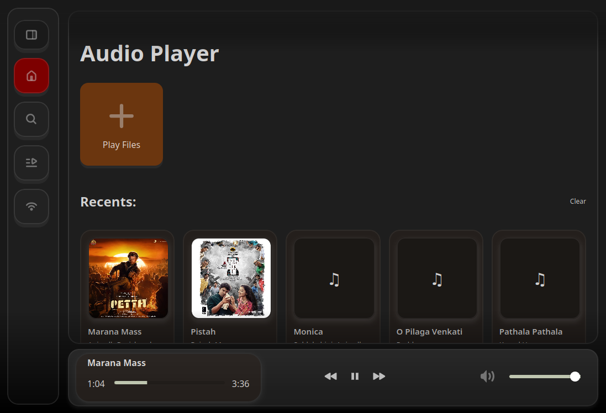

# Music Player


<div>
</div>


A fairly customizable music player made from Rust, Tauri and FFmpeg for Linux.

[](https://www.gnu.org/licenses/gpl-3.0.en.html)[](CONTRIBUTING.md)

## Features

- **1:** Easy to use interface.
- **2.** Customizable UI and options.
- **3.** Linux-native application with integration.

## Prerequisites

You need to have `FFmpeg` with `web2gtk` installed on your Linux distribution.

### For Debian based:

```
sudo apt install libwebkit2gtk-4.1-0 libgtk-3-0 libappindicator3-1 ffmpeg
```

### For Fedora / RHEL based

```
sudo dnf install webkit2gtk4.1 gtk3 libappindicator-gtk3 ffmpeg
```

### For Arch based

```
sudo pacman -S webkit2gtk gtk3 libappindicator-gtk3 ffmpeg
```

## Opening the Application

**Download the AppImage of the latest Release from link.**

[Releases](https://github.com/JQx-999/MusicPlayer/releases)


### Using File Manager

1. Open your **file manager** and browse to the location of the downloaded file.
2. Right-click on the downloaded file and select **Properties**.
3. Go to the **Permissions** tab.
4. Check the box labeled "**Allow executing  file as program**".
5. Close the properties window and **double-click** the AppImage file to launch it.

### Using Terminal

1. Open your **terminal**.
2. Use the following command: 

    ```
    chmod u+x "path-to-your-file.AppImage" && "./path-to-your-file.AppImage"
    ```


## Contributing

Contributions are always welcome! Please read our [CONTRIBUTING.md](CONTRIBUTING.md) to get started.

## Screenshots

<table>
  <tr>
    <td>
    <p>Home Screen</p></td>
    <td>
    <p>Search Page</p></td>
  </tr>
</table>
<table>
  <tr>
    <td>
    <p>Collections Page</p></td>
    <td>
    <p>Stream Page</p></td>
  </tr>
</table>

## Recommended IDE Setup

- [VS Code](https://code.visualstudio.com/) + [Tauri](https://marketplace.visualstudio.com/items?itemName=tauri-apps.tauri-vscode) + [rust-analyzer](https://marketplace.visualstudio.com/items?itemName=rust-lang.rust-analyzer)

## A bit about this program

This program uses FFmpeg for decoding and providing audio stream while using CPAL to output audio. This also uses walkdir along with nucleo-matcher to create fuzzy search function. It has internet radio discovery from Radio Browser API and playback. Using CSS to shape the UI structure.


## License

This project is licensed under the [GNU GPL v3 License](https://www.gnu.org/licenses/gpl-3.0.en.html).